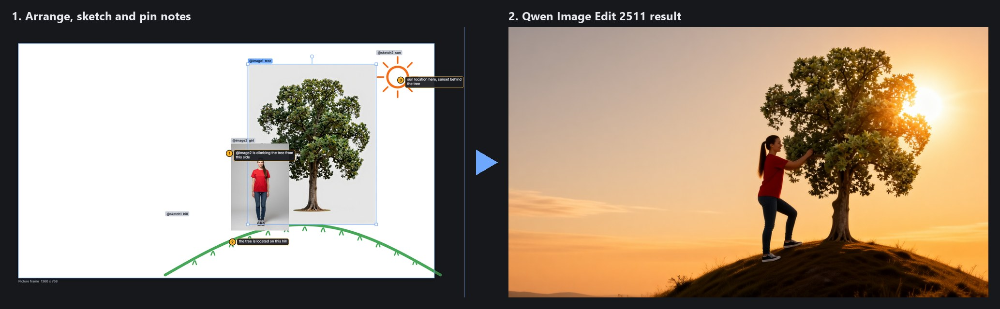
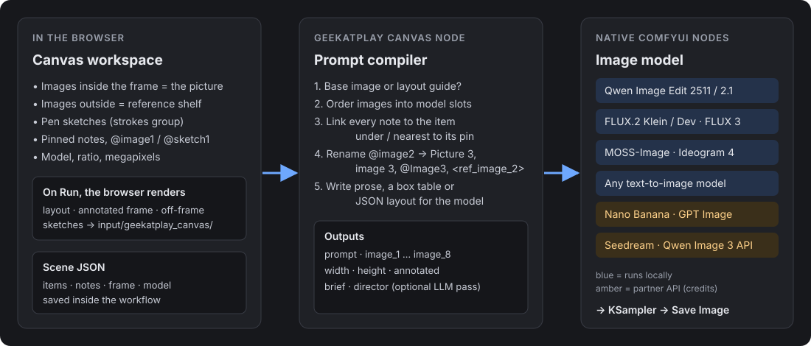
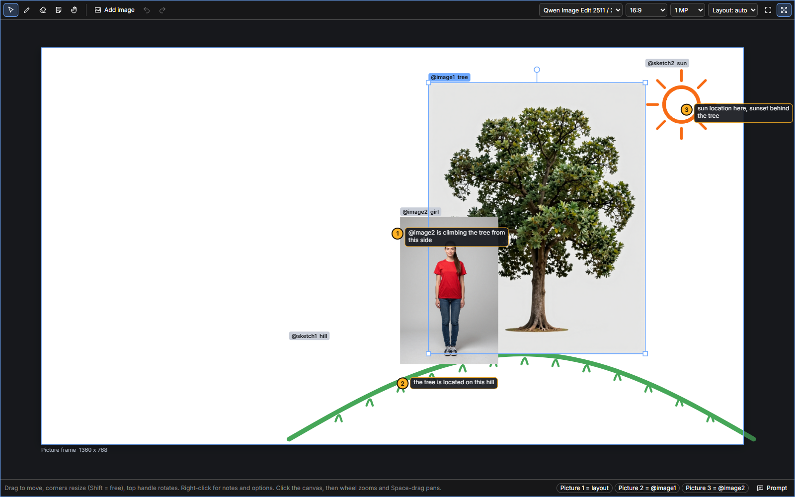
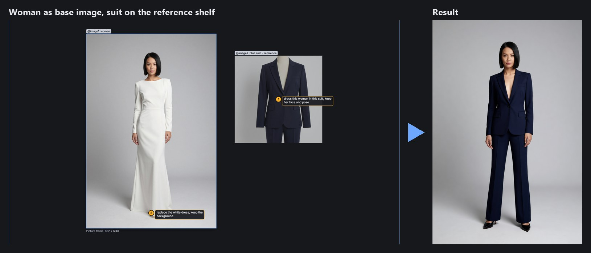
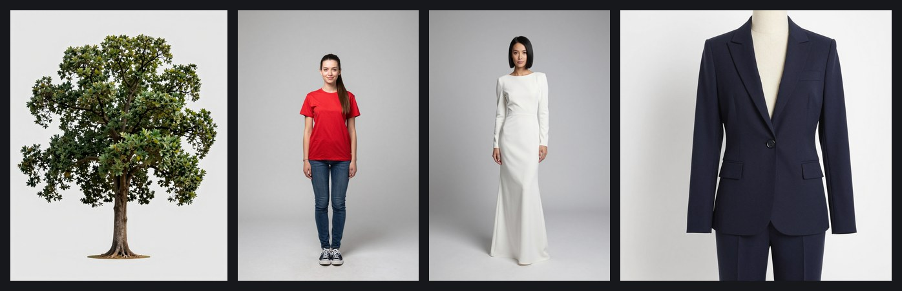
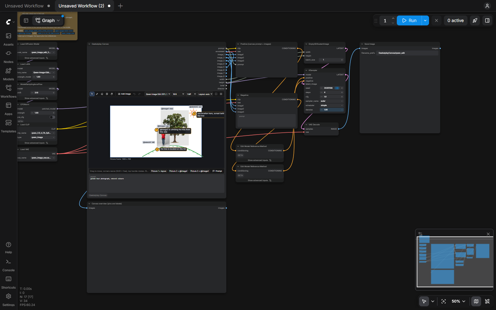

# Geekatplay Canvas for ComfyUI

**A visual workspace node: arrange reference images, sketch, pin notes, and let the image model build the picture.**

By [Geekatplay Studio](https://github.com/GeekatplayStudio) (Vladimir Chopine).



*A tree and a girl dropped on the canvas, a hill and a sun drawn with the pen, three notes pinned:
"@image2 is climbing the tree from this side", "the tree is located on this hill", "sun location here,
sunset behind the tree". One click on Run, local Qwen Image Edit 2511, 4 steps.*

---

## Contents

- [What it does](#what-it-does)
- [Install](#install)
- [Quick start](#quick-start)
- [Examples](#examples)
- [Supported models](#supported-models)
- [Included workflows](#included-workflows)
- [Node outputs](#node-outputs)
- [Tips for good results](#tips-for-good-results)
- [Troubleshooting](#troubleshooting)
- [Tests](#tests)
- Full guides: **[User guide](docs/USER_GUIDE.md)** · **[How it works](docs/HOW_IT_WORKS.md)**

## What it does

Text prompts are a poor way to say *"this girl, from this photo, climbing that tree, from this side,
with the sun over there"*. Geekatplay Canvas lets you show it instead:

| You do on the canvas | The node turns it into |
| --- | --- |
| Drop images **inside the frame** and move, scale, rotate them | Their position in the picture, plus a layout guide image |
| Drop images **outside the frame** (the reference shelf) | Pure references: "dress her in *this* suit" |
| Draw with the pen | Sketch items the model sees (a hill, a sun, a hairstyle) |
| Right-click anywhere and pin a note | An instruction tied to the image or sketch under the pin |
| Write `@image2` or `@sketch1` in a note | The selected model's own name for that image (`Picture 3`, `image 3`, `@Image3`, `<ref_image_2>`) |
| Pick a model, aspect ratio and size | A prompt in that model's format and the reference images in the order it expects |



Everything runs inside ComfyUI. The node makes no internet requests; partner API models are only
used when you load their workflow and run it.

## Install

**ComfyUI Manager:** *Install via Git URL* with `https://github.com/GeekatplayStudio/ComfyUI-Canvas.git`.

**Manually:**

```bash
cd ComfyUI/custom_nodes
git clone https://github.com/GeekatplayStudio/ComfyUI-Canvas.git
```

Restart ComfyUI and refresh the browser. There are no extra Python dependencies.

Requirements: a recent ComfyUI (tested on 0.44 with frontend 1.58) in a Chromium-based browser
(Chrome, Edge). Both the Nodes 2.0 and the classic graph renderer are supported.

## Quick start

1. Open one of the [included workflows](#included-workflows) (drag the `.json` onto ComfyUI), or add
   the node **Geekatplay Canvas** (category *Geekatplay Studio / Canvas*) yourself.
2. **Add images:** drop files onto the canvas, paste with Ctrl+V, or click **Add image**.
3. **Arrange:** drag to move, corner handles to resize, the top handle to rotate.
   Inside the white frame = part of the picture. Outside = reference only.
4. **Draw** with the pen (`B`) to show things you have no photo of.
5. **Pin notes:** right-click on or next to anything and choose *Add note here*, or press `N` and click.
   Type the instruction, press Enter.
6. Optionally write an overall prompt in the box under the canvas ("golden hour photograph").
7. Check the **Prompt** button in the status bar to see exactly what the model will get, then **Run**.



See the **[User guide](docs/USER_GUIDE.md)** for every tool, shortcut and menu option.

## Examples

### Put a subject into a scene

The opening picture: tree and girl inside the frame, hill and sun drawn, three notes.
The node writes this prompt for Qwen Image Edit (from the **Prompt** panel):

```text
golden hour photograph, natural colours
Create one single, seamless, full-frame image of a new scene. Picture 1 is only a rough sketch of the
arrangement: use it for the positions and sizes of things, but do not copy it, and do not show any
pasted photo, white background, frame or drawn line from it.
The tree from Picture 2 appears once, at the center-right of the picture. Keep its identity and details.
The girl from Picture 3 appears once, at the center of the picture. Keep its identity and details.
Picture 3 (girl) is climbing the tree from this side.
The hill at the bottom-right of the picture: The tree is located on this hill.
The sun at the top-right of the picture: Sun location here, sunset behind the tree.
```

`Picture 1` is the arranged frame rendered without pins and labels, `Picture 2` and `Picture 3` are
the original tree and girl photos.

### Dress someone in a reference outfit

The woman's photo fills the frame, so it becomes the **base image** to edit. The suit sits outside the
frame, on the reference shelf, with a note pinned on it.



```text
Picture 1 is the base image. Keep its composition, framing and everything that is not mentioned below
unchanged. Replace the white dress, keep the background.
Picture 2 (blue suit) is a reference image. Dress this woman in this suit, keep her face and pose.
full body fashion photograph
```

The same pattern works for hairstyles (sketch a haircut on the shelf: "make her hair look like this"),
props, logos, colour palettes or a style reference.

All reference photos in these examples were generated locally with Z-Image Turbo:



## Supported models

The model menu in the canvas toolbar decides how the prompt is written and how many images are sent.
Images beyond the model's limit are dropped with a warning in the status bar (placed images stay
visible through the layout guide).

| Model | Images | Images are called | Connect `prompt` and `image_N` to |
| --- | --- | --- | --- |
| Qwen Image Edit 2511 / 2509 | 3 | `Picture 1` | `TextEncodeQwenImageEditPlus` |
| Qwen Image 2.1 / 2.1 Turbo | 8 | `image 1` | `TextEncodeQwenImage21` |
| FLUX.2 Klein / Dev | 8 | `image 1` | `CLIPTextEncode` + `ReferenceMultiLatent` |
| FLUX 3 Klein | 8 | `<ref_image_0>`, plus an `<obj_N>` box table | `CLIPTextEncode` + `ReferenceMultiLatent` |
| MOSS-Image Edit (edit LoRA) | 8 | `Picture 1` | `TextEncodeMOSSImageEdit` |
| MOSS-Image layout (text to image) | none | JSON layout with bounding boxes | `CLIPTextEncode` |
| Ideogram 4 JSON (text to image) | none | JSON prompt with bounding boxes | `CLIPTextEncode` |
| Any text-to-image model (Z-Image, Krea 2, ...) | none | composition in words | `CLIPTextEncode` |
| Nano Banana 2.1 / Pro *(partner API)* | 8 | `image 1` | `GeminiNanoBanana2V2` |
| OpenAI GPT Image 2.6 *(partner API)* | 8 | `image 1` | `OpenAIGPTImageNodeV2` |
| Seedream 4.5 / 5.0 *(partner API)* | 8 | `image 1` | `ByteDanceSeedreamNodeV3` |
| Qwen Image 3 Edit *(partner API)* | 3 | `@Image1` | `QwenImageEditApi` |
| Generic | 8 | `@image1` | any other multi-reference model |

**Text-only models** cannot see pictures. For them each placed image or sketch becomes a box (MOSS,
Ideogram) or a position in words, described by its **name** and the notes pinned on it, so name your
items (double-click) when you use them.

## Included workflows

In the [`workflows`](workflows/) folder. Each one has a *How to use* note and lists the model files it needs.

| Workflow | Model files | Tested |
| --- | --- | --- |
| **Qwen Image Edit 2511** | `qwen_image_edit_2511_int8_convrot`, Lightning 4-step LoRA, `qwen_2.5_vl_7b_fp8_scaled`, `qwen_image_vae` | Generated on an RTX 3090 |
| **Qwen Image Edit 2511 + AI Director** | the above + `qwen3vl_8b_int8_convrot` | Generated |
| **FLUX.2 Klein 9B** | `flux-2-klein-9b-fp8`, `qwen_3_8b_fp8mixed`, `full_encoder_small_decoder` | Generated |
| **MOSS-Image Layout (text to image)** | `moss_image_sft_int8_convrot`, `qwen3.5_9b_w4a8_gptq`, `flux2-vae_small` | Generated |
| **Nano Banana 2.1 (API)** | none, needs a Comfy account with credits | Loads and validates, not run |



The **AI Director** workflow adds a local vision-language model that looks at the annotated canvas and
the references and appends a one-paragraph description of the final picture to the compiled prompt.
It helps with loose, sketch-heavy layouts; the compiled part keeps the exact image names.

## Node outputs

| Output | Type | What it is |
| --- | --- | --- |
| `prompt` | STRING | The compiled prompt for the selected model |
| `annotated` | IMAGE | The frame with pins and labels, for previews and for an LLM |
| `image_1` … `image_8` | IMAGE | The model's input images, in the order the prompt names them. Unused ones are empty and native nodes skip them |
| `width`, `height` | INT | Frame size, for the empty latent |
| `brief` | STRING | A plain description of the canvas (items, notes, draft prompt) for an LLM |
| `director` | STRING | A system prompt for that LLM |

Inputs: the canvas itself, and `prompt`, the overall description.

## Tips for good results

- **Put things roughly where they end up.** If the girl climbs the tree, place her at the trunk. The
  layout guide carries positions, and a subject placed far from where a note sends it can be drawn twice.
  See [How it works](docs/HOW_IT_WORKS.md#why-the-wording-matters) for the experiment behind this tip.
- **Name your items** (double-click): "tree", "blue suit". Names go straight into the prompt.
- **One image filling the frame = edit mode.** It becomes the base image and everything else is
  described as a change to it. Right-click an image and choose *Use as base image* to set this up.
- **Keep references off the frame** when you only want their look (clothes, hair, style), not their position.
- Edit models sometimes keep a drawn shape literally (a sun icon). Describe the sketch in its note
  ("sun here, real sunset light") or try another seed.
- Qwen Image Edit takes **3 images**: the layout plus two references. Use FLUX.2 or a partner model
  for more.

## Troubleshooting

| Problem | Fix |
| --- | --- |
| The wheel zooms the graph instead of the canvas | Click inside the canvas first. Until it has focus the wheel belongs to the graph, as ComfyUI expects |
| *"... is missing from the input folder"* | An image in a shared workflow is not in your `input/geekatplay_canvas/` folder. Drop it onto the canvas again |
| The result copies the pasted collage | Write the overall prompt as the scene you want, and keep subjects where they belong (see tips) |
| An image is ignored | The status bar shows a warning when a model takes fewer images than you placed |
| The canvas is too small | Resize the node, or use the maximize button (Esc to return) |

Dropped images are stored in `ComfyUI/input/geekatplay_canvas/`. Every run of a changed canvas also
writes small `render_*.png` files there; old ones can be deleted at any time.

## Tests

```bash
python -m unittest discover -s tests
node tests/e2e/canvas_e2e.mjs --base=http://127.0.0.1:8188
```

The unit tests cover the prompt compiler for every model profile. The end-to-end test drives the
real node in headless Chrome with real mouse and keyboard input (81 checks, run under both Nodes 2.0
and the classic renderer): moving, resizing, rotating, drawing, erasing, notes, menus, zoom and pan,
paste and drop, undo, maximize, save and reload, and a real queued run.

## Project layout

```
__init__.py        registers the node and two small HTTP routes (model list, prompt preview)
canvas_node.py     the ComfyUI node (V3 schema): loads images, returns the outputs
compiler.py        turns a canvas scene into a prompt + ordered images for one model
profiles.py        model profiles: image limits, naming, layout format
web/               the canvas (workspace.js, workspace.css) and its ComfyUI glue (gap_canvas.js)
workflows/         ready-to-run workflows
docs/              guides and illustrations
tests/             unit tests and the browser end-to-end test
```
