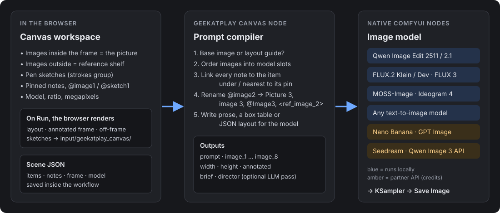
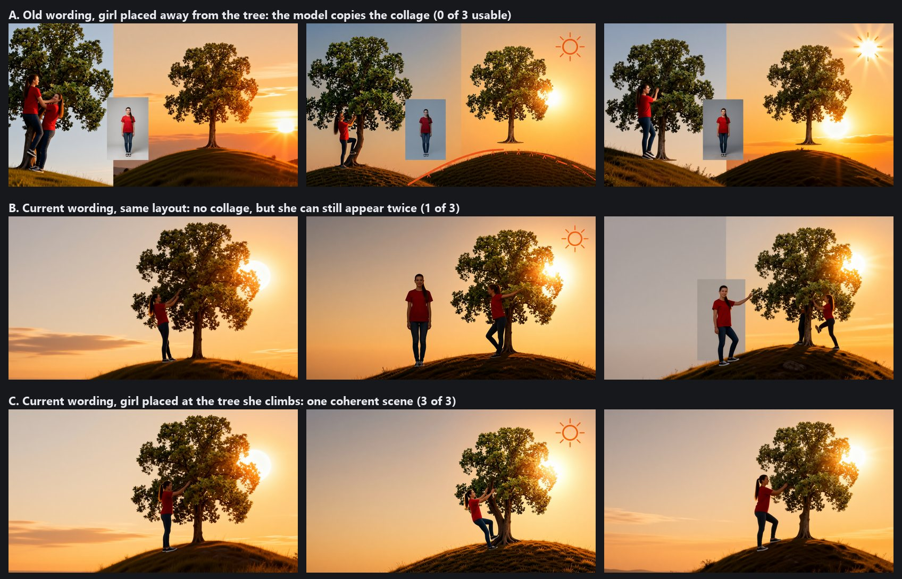

# How it works

What happens between your canvas and the image model. Back to the [README](../README.md).



## 1. In the browser

The canvas ([`web/workspace.js`](../web/workspace.js)) is plain JavaScript drawing on an HTML canvas,
with no framework. It keeps a **scene**: the frame size, the selected model and a list of items
(images, sketches with their strokes, notes with their pin positions). The scene is the node's widget
value, so it is saved in the workflow.

When you queue the workflow, the browser renders and uploads three kinds of images to
`input/geekatplay_canvas/`, named by a hash of the scene so unchanged canvases are not uploaded again:

| Render | Used as |
| --- | --- |
| `render_<hash>_l.png`, the frame without pins or labels | The layout guide (first model image) |
| `render_<hash>_a.png`, the frame with pins and labels | The `annotated` output |
| `render_<hash>_s<id>.png`, each shelf sketch on white | A sketch reference image |

While you edit, the canvas asks the server for a live preview of the compiled prompt
(`POST /geekatplay_canvas/compile`) to fill the **Prompt** panel and the status bar.

## 2. The prompt compiler

[`compiler.py`](../compiler.py) is pure Python with no ComfyUI imports. For the chosen
[model profile](../profiles.py) it decides:

1. **Edit or compose.** One unrotated image covering 90% of the frame is a base image to edit, for
   every model that takes images. Otherwise, if anything is placed and the profile uses a layout guide,
   the rendered frame becomes image 1. Without a guide, placed images get a *"new scene"* opening line,
   and placed sketches the model cannot see are described by their notes and position only.
2. **Image slots.** Real images first, then shelf sketches, in label order. When there are more images
   than the model takes, placed items are dropped first (they still show in the layout guide) and a
   warning is raised.
3. **Note targets.** Each note belongs to the item under its pin (topmost first). Otherwise to the
   nearest item within 30% of the frame diagonal. Otherwise to its position in a 3 x 3 grid of the frame.
4. **Names.** `@image2` / `@sketch1` are replaced with the model's token for that slot, or with a
   description ("the hill at the bottom-right of the picture") when the item has no slot.
5. **Format.** Prose for multi-reference models, a JSON layout with centre-origin pixel boxes for
   MOSS-Image, an Ideogram-style JSON with 0-1000 boxes for Ideogram 4, prose plus an `<obj_N>`
   table for FLUX 3.

## Why the wording matters

Multi-reference edit models treat their first image as something to edit. Early versions described
the layout guide as *"a rough layout guide ... a collage ... recreate it"*, and Qwen Image Edit kept
the collage: pasted photo insets and split backgrounds (row A).

Two changes fixed that:

- **The goal comes first.** The prompt now opens with your description and *"Create one single,
  seamless, full-frame image of a new scene"*, and calls image 1 *"only a rough sketch of the
  arrangement"* that must not be copied.
- **Notes go inside their subject's sentence**, without leads like *"next to the girl, on her left
  side: ..."*. Such leads made the model add a second copy of the subject on that side.



Same three seeds in every row, Qwen Image Edit 2511 with the Lightning 4-step LoRA:

- **A:** old wording, girl placed away from the tree. The collage is copied every time.
- **B:** current wording, same layout. No more collage, but the girl can still appear twice, once where
  she was placed and once where the note sends her.
- **C:** current wording, girl placed at the tree she climbs. One coherent scene every time.

So the layout still matters: put subjects roughly where they should end up.

**MiniMax H3 Image** goes further: it always edits `<Picture 1>`, so with the layout guide it repainted
the collage itself, white background, scribbles and all. Its profile therefore sends no guide. Placed
images are introduced with *"Create one single, seamless, full-frame image of a new scene. Take only the
subjects from the pictures, not their backgrounds."*, sketches become position notes (*"At the
bottom-center of the frame: Rocky hill."*), and the AI director supplies the scene description.

## 3. The node

[`canvas_node.py`](../canvas_node.py) is a V3 ComfyUI node. It compiles the scene, loads the images for
each slot from the input folder (refusing paths outside it), and returns the prompt, the images,
the frame size and the two LLM strings. It knows nothing about the models it feeds: the workflow
connects its outputs to the model's own native nodes.

## The optional AI director

`brief` describes the canvas in plain words (items, slots, notes in order, the draft prompt) and
`director` is a system prompt asking a vision-language model to describe the final picture in one
paragraph. In the *Qwen Image Edit + AI Director* workflow, a local Qwen3-VL 8B reads the brief together
with the annotated canvas and the reference images, and its paragraph is appended to the compiled prompt.
In the *MiniMax H3 Image (local)* workflow the director is on by default (Qwen3.5 9B) and its paragraph
comes first, so a canvas with only images, sketches and notes still gets a full scene description.

Small local models are good at describing a scene but unreliable at keeping image tokens like
`Picture 3` straight, so the director only adds description; the compiled prompt keeps the exact
references.

## Scene format

The scene saved in the workflow, abridged:

```json
{
  "v": 1,
  "model": "qwen_edit",
  "layout": "auto",
  "frame": { "ratio": "16:9", "mp": 1, "w": 1360, "h": 768 },
  "items": [
    { "id": "tree0001", "type": "image", "n": 1, "name": "tree",
      "file": { "name": "example_tree.png", "subfolder": "geekatplay_canvas", "type": "input" },
      "cx": 960, "cy": 330, "w": 420, "h": 525, "rot": 0 },
    { "id": "hill0001", "type": "sketch", "n": 1, "name": "hill",
      "cx": 930, "cy": 668, "w": 900, "h": 200, "bw": 900, "bh": 200, "rot": 0,
      "strokes": [{ "c": "#46a758", "s": 9, "p": [0, 190, 30, 172] }] },
    { "id": "note0001", "type": "note", "n": 1, "x": 690, "y": 360,
      "text": "@image2 is climbing the tree from this side" }
  ]
}
```

Positions are frame pixels with the origin at the frame's top-left; `cx`/`cy` are item centres and
`rot` is in radians. Sketch strokes are stored in the sketch's own box (`bw` x `bh`) so the sketch
scales as one object.

## Adding a model

Add a `Profile` in [`profiles.py`](../profiles.py): the image limit, how image N is named, its index
base, the layout format and whether it uses a layout guide. Then build a workflow that connects
`prompt` and `image_1..N` to that model's encoder. No other code needs to change.
