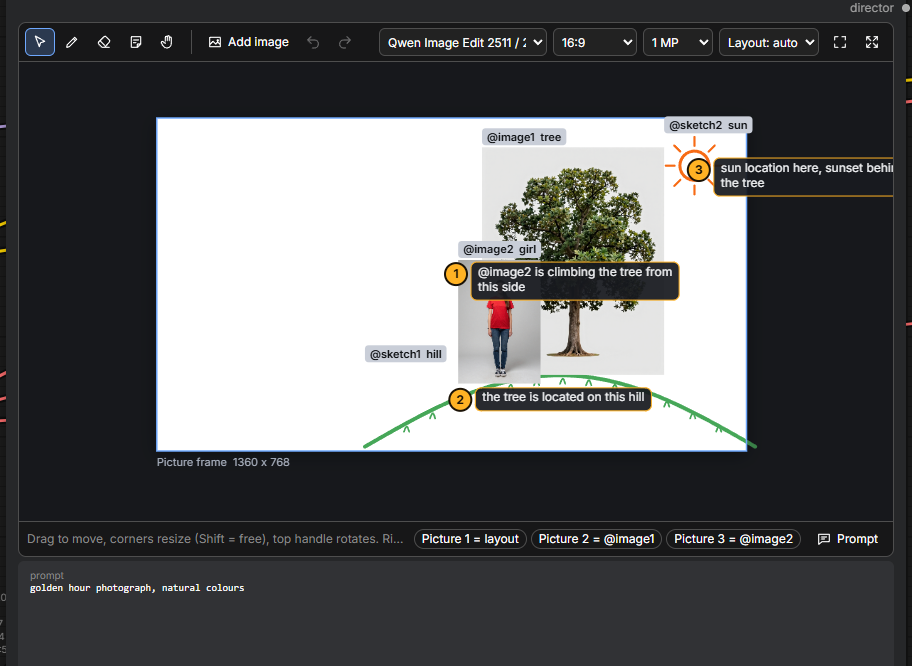
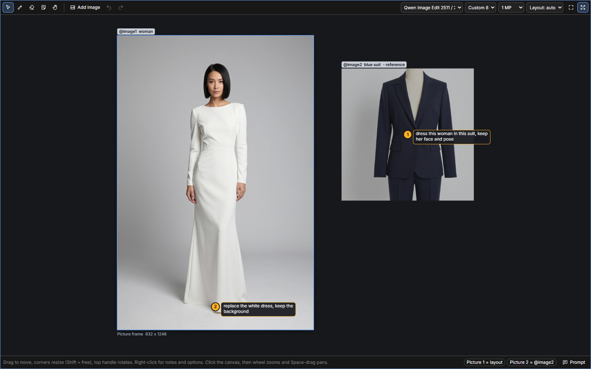
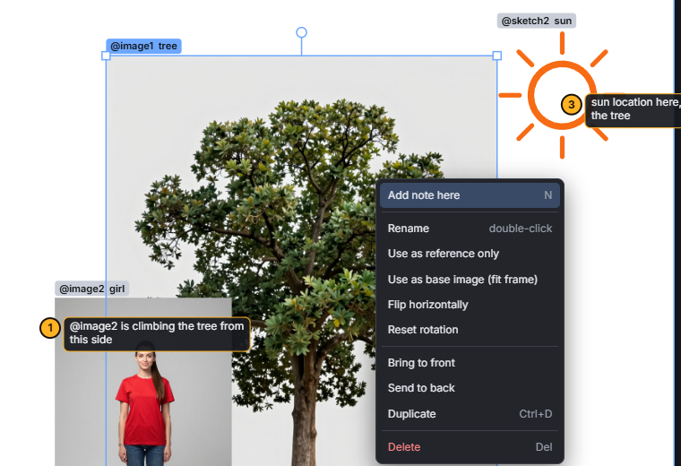
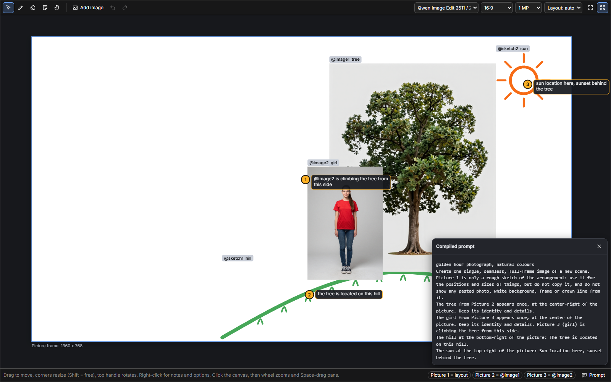

# User guide

Everything the canvas can do, tool by tool. Back to the [README](../README.md).

- [The workspace](#the-workspace)
- [Frame and reference shelf](#frame-and-reference-shelf)
- [Images](#images)
- [Drawing](#drawing)
- [Notes](#notes)
- [Naming and @mentions](#naming-and-mentions)
- [Model, ratio and size](#model-ratio-and-size)
- [Layout guide](#layout-guide)
- [The right-click menu](#the-right-click-menu)
- [Checking the prompt](#checking-the-prompt)
- [Keyboard shortcuts](#keyboard-shortcuts)
- [Saving and sharing](#saving-and-sharing)

## The workspace

The node holds a resizable workspace. From left to right the toolbar has:

| Control | Purpose |
| --- | --- |
| Select (`V`), Pen (`B`), Eraser (`E`), Note (`N`), Hand (`H`) | Tools |
| Colour swatches, custom colour, brush size | Shown while the pen or eraser is active |
| **Add image**, Undo, Redo | |
| Model menu | Which image model the prompt is written for |
| Aspect ratio, megapixels | Size of the picture frame |
| Layout: auto / on / off | Whether the arranged frame is sent as the first image |
| Fit view (`F`), Maximize | Maximize fills the browser window; `Esc` brings it back |

The status bar shows a hint for the current tool, which canvas item went into which model slot
(`Picture 2 = @image1`), warnings, and the **Prompt** button.

**Zoom and pan:** click inside the canvas, then use the mouse wheel to zoom around the cursor and hold
`Space` and drag (or use the Hand tool) to pan. On a touch screen, pinch with two fingers. Until you
click into the canvas, the wheel keeps zooming the ComfyUI graph.

## Frame and reference shelf

The **white rectangle is the picture frame**, the exact output size. Its size is shown under it.

- An image or sketch whose **centre is inside the frame** is *placed*: its position and size matter.
  The prompt says where it is ("center-right of the picture").
- Anything **outside the frame** sits on the **reference shelf**: it is sent to the model as a reference,
  without a position. Shelf items carry a "- reference" tag.
- *Use as reference only* in the right-click menu turns a placed item into a reference without moving it.
- An unrotated image that **covers at least 90% of the frame** becomes the **base image**: the prompt
  then asks the model to edit that image and keep everything not mentioned unchanged.

## Images

- **Add:** drag files from your desktop or another browser tab, paste from the clipboard (`Ctrl+V`),
  or click **Add image** (several files at once are fine). New images are placed at the centre of the view.
- **Move:** drag. Arrow keys nudge by one pixel, `Shift`+arrows by ten.
- **Resize:** drag a corner handle. The aspect ratio is kept; hold `Shift` to stretch freely.
- **Rotate:** drag the round handle above the item. It snaps to straight near 0°; hold `Shift` for 15° steps.
- **Select several:** drag a rectangle on empty space, or `Shift`+click. `Ctrl+A` selects everything.
- **Order:** *Bring to front* / *Send to back* in the right-click menu.
- **Flip** and **Use as base image** are in the right-click menu too.

Images are uploaded to `ComfyUI/input/geekatplay_canvas/` and the workflow stores only their names.

## Drawing

Press `B` for the pen, pick a colour and a brush size (`[` and `]` change the size).

Strokes drawn **close to each other merge into one sketch item**, so a hill drawn with a few strokes is
one thing you can move, resize, name and annotate. A stroke far away starts a new sketch.
The eraser (`E`) removes whole strokes it touches; an empty sketch disappears.

Sketches inside the frame reach the model through the layout guide. For models without a guide
(FLUX 3, MiniMax H3 Image local) a sketch inside the frame is described by its name or its notes and
position, so pin a note on it ("rocky hill"). Sketches on the shelf are rendered on white and sent as
their own reference image, which is how you show a hairstyle or a logo shape.

## Notes

Notes are instructions pinned to a spot:

- Right-click and choose **Add note here**, or press `N` and click anywhere.
- Type the instruction. `Enter` saves, `Shift+Enter` adds a line, `Esc` cancels.
- Double-click a pin to edit it. Drag a pin to move it. An empty note is removed.

**Where you pin matters.** A note belongs to the image or sketch under its pin. Pinned on empty space,
it belongs to the nearest item if that is close, otherwise to that spot in the frame
("At the top-left of the picture: ..."). Notes are numbered in the order you create them.

Good notes are short and concrete: *"dress this woman in this suit"*, *"make her hair look like this"*,
*"the tree stands on this hill"*, *"sun here, warm sunset light"*.

## Naming and @mentions

Every item gets a label: `@image1`, `@image2`, `@sketch1`. Double-click an item to give it a name
("tree"); the name appears on its label and in the prompt.

Write a label in a note or in the overall prompt to point at that item:
*"@image2 is climbing the tree from this side"*. The node replaces it with the selected model's name
for that image, so the same canvas works for any model:

| Model | `@image2` becomes |
| --- | --- |
| Qwen Image Edit | `Picture 3 (girl)` |
| FLUX.2, Qwen 2.1, partner models | `image 3 (girl)` |
| FLUX 3 | `<ref_image_2> (girl)` |
| MiniMax H3 Image (local) | `<Picture 3> (girl)` |
| Qwen Image 3 API, MiniMax H3 Image API | `@Image3 (girl)` |
| Text-only models | `the girl` |

(The numbers shift by one when a layout guide takes the first slot.)

## Model, ratio and size

Pick the model in the toolbar to match the workflow you run. It changes the prompt format, how many
images are sent, and how images are named. See the [model table](../README.md#supported-models).

Aspect ratios: 1:1, 4:3, 3:4, 3:2, 2:3, 16:9, 9:16, 21:9, 9:21, 5:4, 4:5, 2:1, 1:2.
Sizes: 0.5, 1, 1.5, 2 and 4 megapixels. Sides are rounded to multiples of 16. Changing the ratio keeps
your arrangement in proportion. *Use as base image* switches to a custom ratio matching the photo.

The `width` and `height` outputs carry the frame size to the empty latent.

## Layout guide

When at least one item is placed in the frame, the canvas renders the frame (without pins and labels)
and sends it as the model's first image, so the model sees where things go.

- **auto** (default): on for models that accept images, off for FLUX 3, which gets a bounding-box table
  instead, and for MiniMax H3 Image (local), which would repaint the guide; its workflow uses the AI
  director to describe the scene. A base image filling the frame is sent in every mode except *off*.
- **on / off:** force it. With *off*, placed items are sent only as references and their positions go into words.

## The right-click menu

On an item: add a note, rename, toggle *reference only*, use as base image, flip, reset rotation,
bring to front, send to back, duplicate (`Ctrl+D`), delete (`Del`).
On empty space: add a note, add an image, fit the view, clear the canvas. Everything can be undone.

## Checking the prompt

**Prompt** in the status bar opens the exact text the model will receive, updated live as you edit.
Warnings appear above it, for example when the model takes fewer images than the canvas holds.

## Keyboard shortcuts

Shortcuts work while the canvas has focus (click into it). They never reach the ComfyUI graph.

| Key | Action |
| --- | --- |
| `V` `B` `E` `N` `H` | Select, pen, eraser, note, hand |
| `Space` + drag | Pan |
| Mouse wheel | Zoom around the cursor |
| `F` | Fit everything in view |
| `[` / `]` | Smaller / larger brush |
| `Ctrl+Z` / `Ctrl+Shift+Z` or `Ctrl+Y` | Undo / redo |
| `Ctrl+A` | Select all |
| `Ctrl+D` | Duplicate selection |
| `Delete` / `Backspace` | Delete selection |
| Arrows / `Shift`+arrows | Nudge by 1 / 10 pixels |
| `Esc` | Close a menu or editor, clear the selection, leave maximized mode |
| Double-click | Edit a note, rename an item |

## Saving and sharing

The whole canvas (items, sketches, notes, model, frame) is saved inside the workflow like any other
widget value. Images are referenced by file name, so when you share a workflow, also share the files
from `input/geekatplay_canvas/` that it uses.
